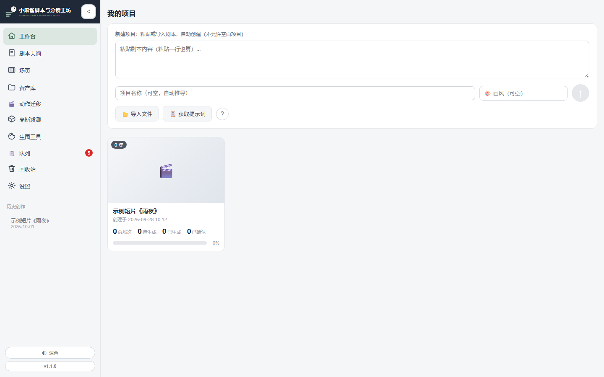
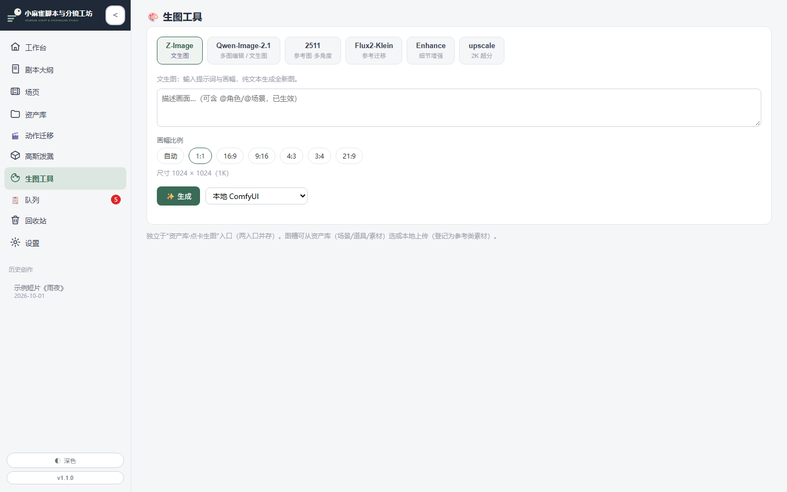
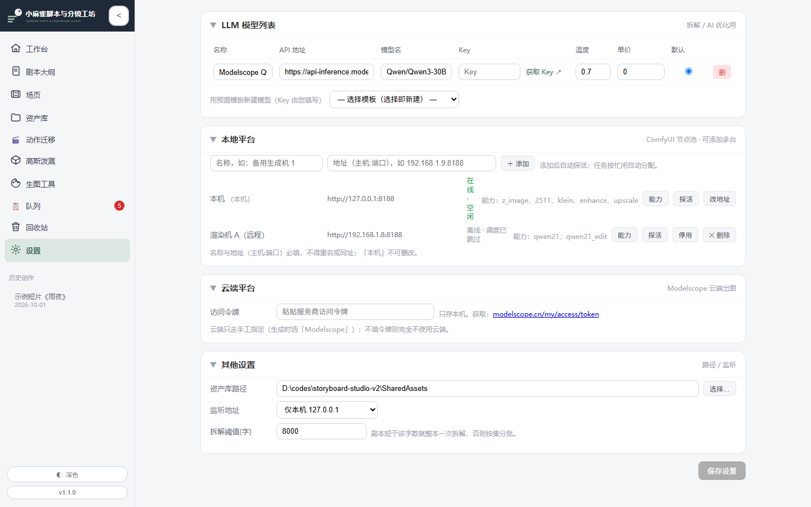

# 小麻雀剧本分镜工坊（xiaomaque-storyboard-studio）

> AI 影视分镜创作工作台 —— 把「剧本 → 分镜 → 资产 → 图/视频生成」全流程，在一个**本地工作台**内闭环。
>
> ★ 本仓为 **v2 升版**（在 v1 基础上接入 AI 生图能力与任务队列 / 多节点调度）。
>
> **当前版本：`1.1.0`** ｜ 变更历史见 **[CHANGELOG.md](CHANGELOG.md)**

---

## 简介

面向影视短片 / 短剧创作者的本地方案：导入剧本，AI 拆解为剧集 / 场 / 镜结构，沉淀人物 / 场景 / 道具资产库，
并以可配置的 **ComfyUI** 后端完成**图像生成与编辑**、**场视频生成**。
**所有资产与数据归你所有，本地存储，不依赖云端。**

## 核心能力

- **剧本管理**：docx / PDF 导入、剧本摘要、剧集 / 场 / 镜结构化拆解、@引用组件
- **资产库**：人物 / 场景 / 道具三类卡片，变体管理、图片版本历史、人物音色样本
- **场视频生成**：多说话人视频（参考图 + 参考音色 + 六段式提示词），历史版本切换
- **提示词工程**：画风库、自动组装（场景 / 角色 / 道具 / 运镜）
- **批量资产提取**：按场 / 集 / 全剧本批量提取并自动归属
- **3D 高斯泼溅预览**：gsplat 资产的可视化预览

## ★ v2 升版新增

| 能力 | 说明 |
|:--|:--|
| **动作迁移** | 参考视频 → 目标角色动作迁移 |
| **指令编辑** | 自然语言指令编辑已有图像（Qwen-Edit） |
| **细节增强** | 图像细节增强（强度可调） |
| **生图工具面板** | 独立生图/编辑工作台，多模式（含 **Qwen-Image-2.1** 文生图 / 编辑），支持 1K / 2K |
| **任务队列** | **统一任务队列**：持久化、排队、取消、重试、重排；全站生成类任务统一入队 |
| **多节点后端池** | 可添加**任意数量** ComfyUI 节点（设置页纯配置，零代码改动）；健康探活 + 负载均衡 |
| ★ **节点能力匹配** | 每个节点可声明「能跑哪些工作流」，任务**只在能力匹配的节点里派发**；无匹配节点时**明确报错**（而不是打到后端才失败） |
| **云端生图（可选）** | 可对接 ModelScope 云端推理，作为本地算力的补充通道（需自备令牌） |
| **回收站** | 删除的素材进入回收站，可恢复；支持保留期自动清理 |

## 兼容性（重点）

- **任意 ComfyUI**：在「设置」页填入你的 ComfyUI 地址即可接入，**不绑定特定部署**；
  远程 ComfyUI（经内网 / 异地组网等，任意可达地址）同样支持 —— 只要地址可达即可。
- **工作流即插即用**：本项目 `workflows/custom/` 下的工作流，只需在你的 ComfyUI 中能跑通，工坊即可直接调用。
  ★ 注意：**不同工作流依赖不同模型/自定义节点**，请按你的实际部署，用「节点能力」把任务指派给跑得动的节点。
- **生图自动捕获**：工坊后台监听共享资产目录树（`SharedAssets`），**任何来源**落入该目录的图片都会**自动感知并资产化**，
  无需手动收录；监听根目录可在「设置」页配置。

## 架构

```
浏览器（static/ 前端）
      │
      ▼
FastAPI 后端（main.py，默认 127.0.0.1:3100）
      ├── 本地数据层（data/ JSON + SharedAssets/ 媒体，目录监听自动资产化）
      ├── 统一任务队列（持久化 / 取消 / 重试 / 多槽调度）
      └── ComfyUI 节点池（可配多节点 + 能力匹配 + 探活；可另接云端）
```

## 界面预览

| 工作台 | 生图工具 |
|:--:|:--:|
|  |  |

**设置 · 多节点后端池** —— 可添加任意数量 ComfyUI 节点，★ 每个节点可声明「**能跑哪些工作流**」（能力匹配）：



## 快速开始（方式二 · 源码版）

**前置**：**Python 3.10 ~ 3.12**（★ **不要用 3.13+**：`audioop` 已被移除，音频校验会报错）
＋ 可访问的 ComfyUI 实例（含 `workflows/custom/` 所需工作流与模型）

1. 获取代码（本仓 或 **发布包**）
2. 双击 `run.bat` 一键启动（或 `python main.py`）
3. 浏览器打开 `http://127.0.0.1:3100`
4. 在「设置」页填入 ComfyUI 地址（远程实例经内网 / 异地组网等可达即可），**并按需为节点标上能力**

> 首次启动会自动初始化数据目录与示例结构。

## 目录结构

```
├── main.py               # FastAPI 后端（端点装配）
├── routers_*.py          # 各领域路由（任务 / 节点 / 生成 / 编辑 / 增强 / 视频 / 回收站 / 文件 …）
├── task_queue.py         # 任务队列与调度（多槽 / 按节点锁 / 取消语义）
├── node_pool.py          # ComfyUI 节点池（探活 / 负载 / ★ 能力匹配）
├── comfy_client.py       # ComfyUI 客户端（工作流装载 / 参数覆盖 / 轮询 / 取消）
├── library.py            # 资产库逻辑（三库 / 引用 / 体检）
├── assets_index.py       # 媒体版本索引 + 目录监听 + 自动资产化
├── static/               # 前端页面与组件
├── data/                 # 运行时数据（JSON，本地存储）
├── workflows/custom/     # 工作流模板（在你的 ComfyUI 中可直接运行）
└── python/               # 可选：项目内嵌 Python 解释器
```

## 数据与隐私

- 全部数据存于本地 `data/` 与 `SharedAssets/`，**不向第三方云上传**；
- 对外仅连接你在设置页配置的 ComfyUI 地址 / （可选）云端推理服务；
- 默认**仅本机访问**（`127.0.0.1`，不对外暴露）；★ **本版本不开放局域网访问**（安全整改中）——
  局域网开关已在设置页停用，外部设备连不上属**预期行为**，不是故障。

## 环境要求

| 项 | 要求 |
|:--|:--|
| **操作系统** | Windows 10 / 11 |
| **Python** | ★ **3.10 ~ 3.12**（**3.13+ 不兼容**）；★ **本发布包统一随带 Python `3.10.11`**，无需自行安装 |
| 依赖 | 见 `requirements.txt`（发布包已内嵌解释器与依赖，无需自行安装） |
| ComfyUI | 任意可达实例（本地或远程） |

> ★ **为什么不能用 3.13+**：音频时长 / 音量校验用到标准库 **`audioop`**，它自 **Python 3.13 起被移除**（PEP 594）。
> 换成 3.13+ 解释器后，**音频校验路径会 `ImportError`**。本包随带的 `3.10.11` 满足此约束，**请勿替换**。
>
> ★ **启动脚本会自适配解释器**：`run.bat` 优先使用**包内** `python\python.exe`（发布态）；
> 若不存在则回退到开发机上的同一套解释器并打印提示；两者都没有时会**明确报错并停止**（不会静默失败）。

## 下载

> ★ **方式一 · 便携版（推荐，免装 Python）** —— GitHub Release 免登录直下：
>
> 直链：`https://github.com/z7w337/xiaomaque-storyboard-studio/releases/download/v1.1.0/xiaomaque-storyboard-studio-portable-20261012.zip`
> 发布页：`https://github.com/z7w337/xiaomaque-storyboard-studio/releases/tag/v1.1.0`
>
> 文件完整性校验（SHA256）：**见发布页说明**（`xiaomaque-storyboard-studio-portable-20261012.zip`，51,557,955 字节）。
>
> ★ 当前仅提供 GitHub 单渠道；若国内下载慢，后续可在此补充网盘备用渠道。

## 技术栈

FastAPI · 原生前端（无框架依赖）· ComfyUI · MiniMax H3 · gsplat.js · **Apache 2.0**

## 版本与更新日志

| 项 | 值 |
|:--|:--|
| **当前版本** | **`1.1.0`** |
| 版本号来源 | 仓库根 `VERSION` 文件 |
| 变更历史 | **[CHANGELOG.md](CHANGELOG.md)** |
| 上一版本 | `0.1.0`（初版） |

## 许可证

[Apache License 2.0](LICENSE)

## 致谢与说明

- 本项目为 **v2 升版**；v1（`0.1.0`）为初版。
- 使用到的第三方模型/工作流，**各自遵循其原始许可**（★ 例如 Qwen-Image-2.1 为「研究用途，商用需向阿里申请授权」——
  商用前请自行确认各模型的授权条款）。
