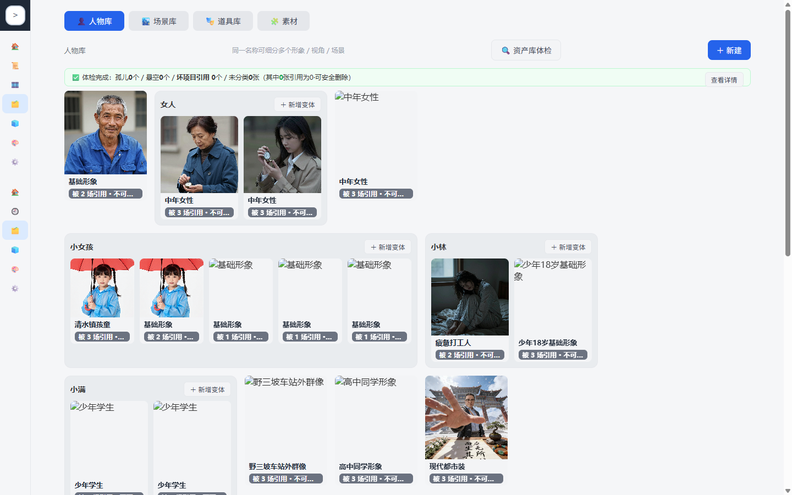
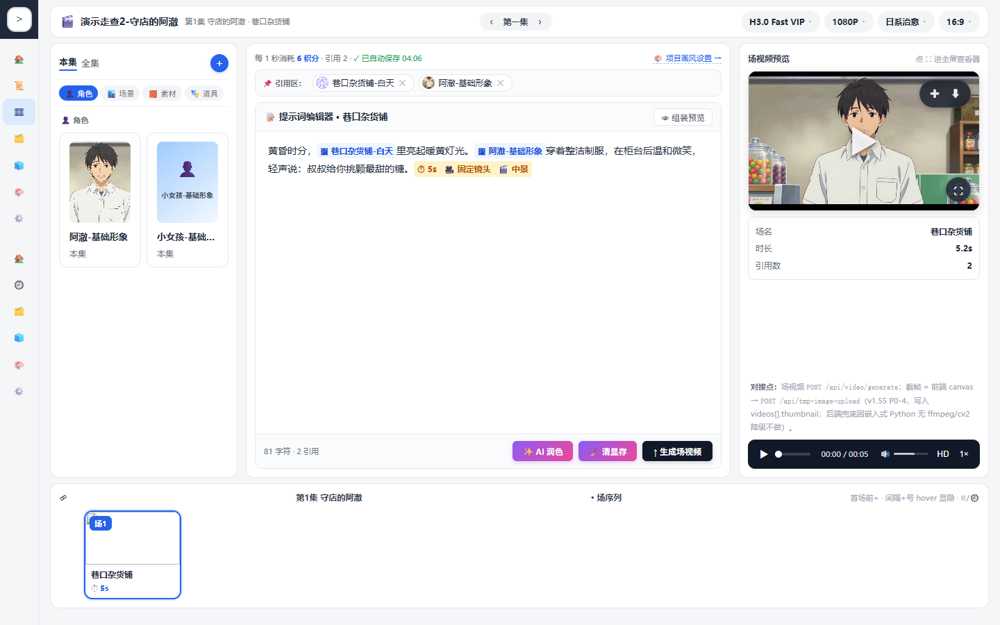
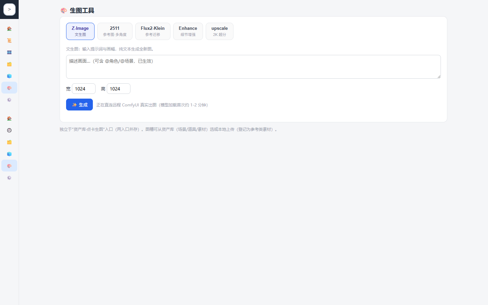
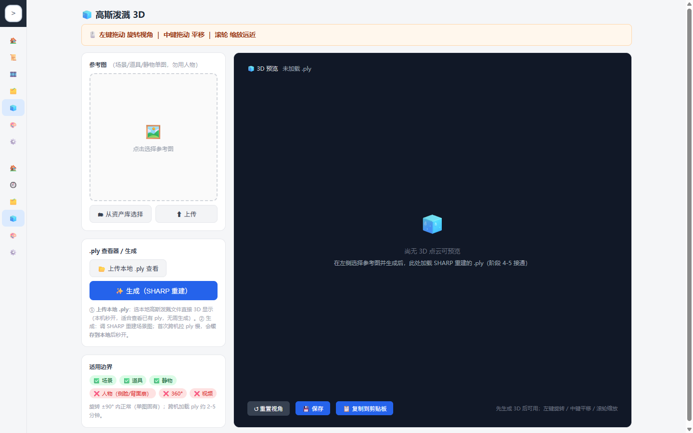

# 小麻雀剧本分镜工坊（xiaomaque-storyboard-studio）

> AI 影视分镜创作工作台 —— 把「剧本 → 分镜 → 资产 → 场视频」全流程在一个本地工作台内闭环。

## 简介

面向影视短片/短剧创作者的本地方案：导入剧本，AI 拆解为剧集/场/镜结构，沉淀人物/场景/道具资产库，并以 MiniMax H3 工作流生成场视频。**所有资产与数据归你所有，本地存储，不依赖云端。**

## 核心能力

- **剧本管理**：docx/PDF 导入、剧本摘要、剧集/场/镜结构化拆解、@引用组件
- **资产库**：人物/场景/道具三类卡片，变体管理、图片版本历史、人物音色样本
- **场视频生成**：多说话人 H3 视频（参考图 + 参考音色 + 六段式提示词），历史版本切换
- **提示词工程**：画风库、自动组装（场景/角色/道具/运镜）、独立生图工具面板
- **批量资产提取**：按场/集/全剧本批量提取并自动归属
- **3D 高斯泼溅预览**：gsplat 资产的可视化预览、缩放、保存入库

---

## 安装（两种方式，任选其一）

### 方式 A · 下载即可运行版（推荐，无需装 Python）

**第 1 步：下载**

文件名：`xiaomaque-storyboard-studio-portable-20260911.zip`（44.7 MB）

**渠道一 · GitHub Release（推荐，免登录直接下载）**

> **直链**：https://github.com/z7w337/xiaomaque-storyboard-studio/releases/download/20260911/xiaomaque-storyboard-studio-portable-20260911.zip
>
> **发布页**：https://github.com/z7w337/xiaomaque-storyboard-studio/releases/tag/20260911

**渠道二 · 夸克网盘（国内速度更快）**

> **链接**：https://pan.quark.cn/s/8748e5722179
>
> **口令**：`/~777f3anbKo~:/`
>
> 用法：点开链接即可；若提示需用 App，则复制上面整段内容，打开「夸克 APP」自动识别。

> 文件完整性校验（可选）：SHA256 `4ffc04045f16f1a7d02d816c6b3bbc6862f2d35daea0669861ebd1f5756e16e1`

**第 2 步：解压**

把下载到的 `xiaomaque-storyboard-studio-portable-*.zip` 解压到任意目录，例如：

```
D:\xiaomaque-storyboard-studio
```

> ⚠️ 解压路径**建议不含中文和空格**，避免个别依赖因路径编码出问题。

**第 3 步：启动**

进入解压后的目录，**双击 `run.bat`** 即可。

自带 Python 运行时（`python\` 目录），**无需另行安装 Python，也无需 pip 安装依赖**；首次启动会自动初始化数据目录，并自动打开浏览器。

---

### 方式 B · Clone 源码版（开发者 / 想自己改代码）

**第 1 步：准备 Python**

安装 **Python 3.10 ～ 3.12**（[python.org 下载](https://www.python.org/downloads/)），安装时勾选 **Add Python to PATH**。

> ❌ **不要用 Python 3.13 及以上**：3.13 起标准库移除了 `audioop` 模块，本项目的音频校验依赖它会直接报错。

验证安装成功（命令行执行，应输出 3.10~3.12 的版本号）：

```bat
python --version
```

**第 2 步：拉取代码**

```bat
git clone https://github.com/z7w337/xiaomaque-storyboard-studio.git
cd xiaomaque-storyboard-studio
```

（也可以直接在 GitHub 页面点 **Code → Download ZIP**，解压后进入该目录。）

**第 3 步：安装依赖**

```bat
pip install -r requirements.txt
```

依赖含 FastAPI / uvicorn / numpy / soundfile / edge-tts 等；如 pip 下载慢，可加国内镜像：

```bat
pip install -r requirements.txt -i https://pypi.tuna.tsinghua.edu.cn/simple
```

**第 4 步：启动**

**双击 `run.bat`**（或在命令行执行 `python main.py`）。

浏览器会自动打开 `http://127.0.0.1:3100/`。

---

## 启动方式（run.bat）

两个版本**用的是同一个 `run.bat`**，它会按下面的顺序自动挑选 Python 解释器：

| 优先级 | 解释器 | 说明 |
|---|---|---|
| ① | `程序目录\python\python.exe` | **下载即运行版自带**；存在就用它，完全不依赖系统环境 |
| ② | 系统 PATH 中的 `python` | Clone 源码版走这里（用你装的 Python 3.10~3.12） |
| ③ | `py -3` | Windows Python 启动器兜底 |

所以：

- **下载即运行版**：解压 → 双击 `run.bat`。因为目录里有 `python\`，会直接用自带运行时。
- **Clone 源码版**：装好 Python + `pip install -r requirements.txt` → 双击 `run.bat`。目录里没有 `python\`，会自动回退到系统 Python。

如果三者都没有，`run.bat` 会给出明确提示：

```
 [错误] 未找到 Python 解释器。
        请安装 Python 3.10 ~ 3.12 并加入 PATH（3.13+ 已移除标准库 audioop，无法运行）；
        或在本目录放置内嵌解释器 python\python.exe 后重试。
```

启动后终端会打印访问地址（默认 `http://127.0.0.1:3100/`）；**按 `Ctrl+C` 停止服务**。

> 监听地址说明：默认**仅本机可访问**（`127.0.0.1`）。如需要在局域网内用手机/其他电脑访问，到「设置」页把监听地址改成 `0.0.0.0`，`run.bat` 下次启动会提示局域网模式（⚠️ 请先确认网络环境安全）。

---

## 配置 ComfyUI 地址（出图 / 生成视频必做）

本项目的生图与场视频生成，都通过你**自己的 ComfyUI** 执行，因此需要告诉工坊 ComfyUI 在哪里。

**第 1 步**：启动工坊后，浏览器打开 `http://127.0.0.1:3100/`。

**第 2 步**：点左侧导航的 **⚙️ 设置**（或直接访问 `http://127.0.0.1:3100/settings.html`）。

**第 3 步**：找到 **「ComfyUI 地址」** 这一行，填入你的 ComfyUI 服务地址：

| 场景 | 填什么 |
|---|---|
| ComfyUI 跑在本机 | `http://127.0.0.1:8188` |
| ComfyUI 跑在局域网另一台电脑 | `http://192.168.x.x:8188` |
| 经 Tailscale 等组网访问远程机器 | `http://100.x.x.x:8188`（填组网 IP） |

**第 4 步**：保存设置。

**第 5 步**：确认连通 —— 到「生图工具」页试生成一张图；能正常出图即配置成功。

> **它存在哪？** 填的值保存在 `data\settings.json` 的 `comfyui_url` 字段里。也可以关掉工坊后直接用记事本编辑该文件：
>
> ```json
> { "comfyui_url": "http://127.0.0.1:8188" }
> ```
>
> 默认值是占位符 `http://<comfyui-ip>:8188`，**不配置就出不了图**。

**同一页还能配**（按需）：

- **资产库路径**：共享资产目录，默认是程序目录下的 `SharedAssets`；**任何来源**落入该目录的图片都会被自动感知并资产化为素材卡。
- **监听地址**：仅本机 `127.0.0.1` / 局域网 `0.0.0.0`。
- **拆解阈值(字)**：剧本字数小于该值时整本一次拆解，否则按集分批（默认 8000）。

---

## 兼容性（重点）

- **任意 ComfyUI**：在「设置」页填入你的 ComfyUI 地址即可接入，不绑定特定部署；
  远程 ComfyUI（如装 **Tailscale** 组网）同样支持——只要地址可达即可。
- **工作流即插即用**：本项目 `workflows/custom/` 下的工作流，只需在你的 ComfyUI
  中能跑通，工坊即可直接调用，无需额外适配。
- **生图自动捕获**：工坊后台持续监听共享资产目录树（`SharedAssets`），**任何来源**
  落入该目录的图片——包括其他生图平台/工具的输出——都会**自动感知并资产化**为素材卡，
  无需手动收录；监听根目录可在「设置」页配置。

## 架构

```
浏览器（static/ 前端）
      │
      ▼
FastAPI 后端（main.py，默认 127.0.0.1:3100）
      ├── 本地数据层（data/ JSON + SharedAssets/ 媒体，目录监听自动资产化）
      └── 远程 ComfyUI（地址在设置页可配，workflows/custom/ 工作流即插即用）
```

## 目录结构

```
├── main.py               # FastAPI 后端（全部端点）
├── library.py            # 资产库逻辑（三库/引用/体检）
├── assets_index.py       # 媒体版本索引 + 目录监听 + 自动资产化
├── comfy_client.py       # ComfyUI 客户端（H3 提示词构造）
├── static/               # 前端页面与组件（资产库/场页/剧本/生图工具/GS 预览）
├── data/                 # 运行时数据（JSON，本地存储；首次启动自动创建）
├── workflows/custom/     # 工作流模板（H3 T8，可在目标 ComfyUI 直接运行）
└── python/               # 可选：项目内嵌 Python 解释器（「下载即运行版」自带）
```

## 数据与隐私

- 全部数据存于本地 `data/` 与 `SharedAssets/`，不向第三方云上传
- 对外仅连接你在设置页配置的 ComfyUI 地址（默认仅本机访问）
- 目录监听自动资产化：图片落入监听目录 → 自动登记为素材卡（无需手动收录）

## 技术栈

FastAPI · 原生前端（无框架依赖）· MiniMax H3 · ComfyUI · gsplat.js · Apache 2.0

## 许可证

[Apache License 2.0](LICENSE)

## 截图

**资产库** —— 人物 / 场景 / 道具三类卡片，变体管理与图片版本历史



**场页** —— 提示词编辑器、@ 引用组装、场视频预览



**生图工具** —— 内置 5 个可选工作流（Z-Image / 2511 / Flux2-Klein / Enhance / upscale）



**3D 高斯泼溅预览** —— .ply 查看，左键旋转 / 中键平移 / 滚轮缩放


